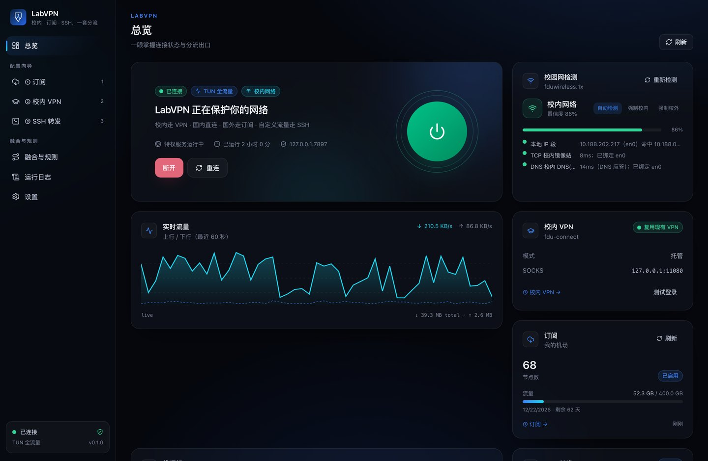
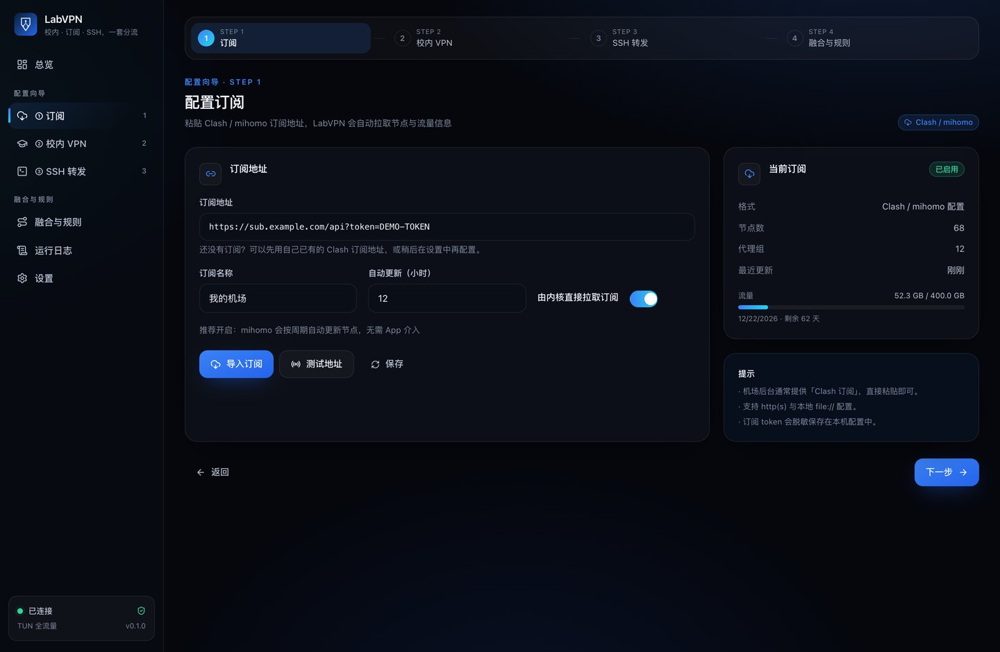
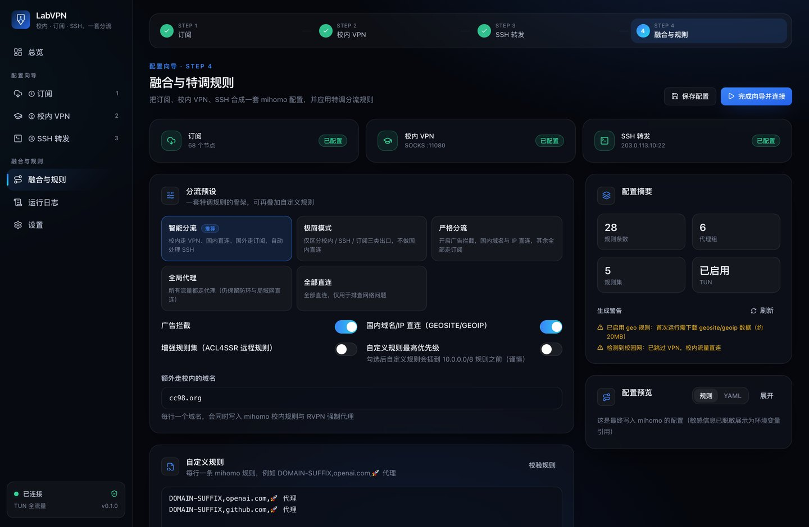
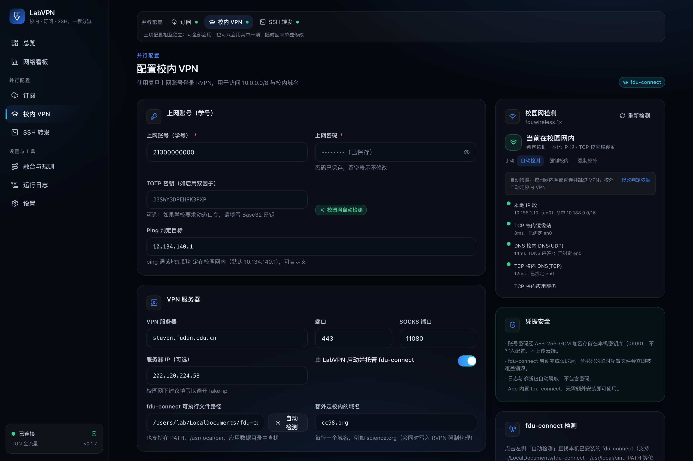
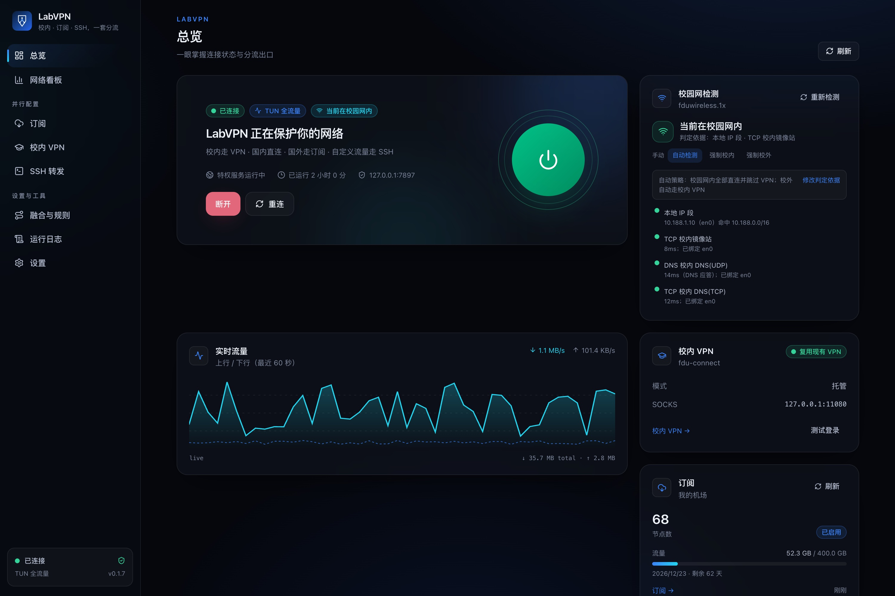

# LabVPN

> 复旦校园网 · 机场订阅 · 公网 SSH —— 一个客户端，自动分流。

[](https://github.com/echo-edai/LabVPN-client/actions/workflows/ci.yml)
[](https://github.com/echo-edai/LabVPN-client/releases/tag/v0.1.1)
[](LICENSE)
[](#平台支持)

LabVPN 把「Clash 订阅 + 复旦 RVPN + 公网 SSH 中转」整合进一个桌面客户端：
**三页配置、一处融合、一套特调分流规则**。基于 Tauri 2 与 mihomo（Clash.Meta），
支持 macOS / Windows / Ubuntu / AlmaLinux。


> **声明（请先阅读）**：本项目仅供复旦同学学习交流与技术研究使用，**不提供、不分享任何 VPN / 机场订阅、账号或代理服务**。
> 使用者需自行准备合法的复旦校园网账号与自己购买/自有的订阅；请遵守学校网络规定与当地法律法规。欢迎 Fork、Issue、PR，一起完善对复旦同学的代理支持。

## 下载

最新预发布版本 **v0.1.1** 已构建四平台安装包，**内置 fdu-connect**（开箱即用）。
当前未配置 Apple/Windows 签名证书，安装时请按下方提示放行：

| 平台 | 产物 |
|---|---|
| macOS ARM / Intel | `LabVPN_0.1.1_aarch64.dmg` / `LabVPN_0.1.1_x64.dmg` |
| Windows 10/11 | `LabVPN_0.1.1_x64-setup.exe` / `.msi` |
| Ubuntu 22.04+ | `.deb` / `.AppImage` |
| AlmaLinux 9+ | `.rpm` |

👉 [Releases · v0.1.1 (pre-release)](https://github.com/echo-edai/LabVPN-client/releases/tag/v0.1.1)

- macOS 未签名：首次打开请右键 → 打开（或 系统设置 → 隐私与安全性 → 仍要打开）。
- Windows 未签名：SmartScreen 提示时选择「仍要运行」。
- 配置签名证书后（见 [BUILD.md §4.1](docs/BUILD.md#41-签名与公证)），Release 会自动签名并公证，实现下载即安装。

## 界面预览



| 三页配置 | 融合与规则 |
|---|---|
|  |  |
|  |  |

更多截图见 [`docs/screenshots/`](docs/screenshots/)。

## 功能

- **自动分流（一套特调规则）**
  - `10.0.0.0/8` 与 `*.fudan.edu.cn` → 校内 VPN（fdu-connect）
  - 中国大陆域名/IP → 直连
  - 国外域名/IP → 订阅节点（自动择优 / 手动选择）
  - 自定义域名/IP → 公网 SSH 出站
  - 广告拦截、局域网/本机直连、防环（VPN 服务器直连）
- **校内网络检测**：多信号（内网探针 + 本机 IP 段 + Wi-Fi SSID），探针绑定物理网卡以
  绕过第三方 TUN 劫持；**在校内自动跳过 VPN，直接连接**，并支持手动覆盖。
- **三页配置向导**
  1. **订阅**：粘贴 Clash/mihomo 订阅地址，自动拉取、显示节点数/流量/到期；
  2. **校内 VPN**：复旦上网账号 + 密码（存钥匙串），自动发现已安装的 fdu-connect；
  3. **SSH 转发**：公网 IP + 端口 + 认证方式，绑定需要走 SSH 的域名/CIDR。
- **融合页**：实时预览 mihomo 配置、规则总览、自定义规则、分流诊断（输入域名/IP 看走向）。
- **TUN 全流量 + 系统代理双模式**：TUN 一次提权启用（helper），不可用时自动降级。
- **跨平台**：macOS（ARM/Intel）、Windows 10/11、Ubuntu 22.04+、AlmaLinux 9+。
- **可扩展**：纯逻辑核心库（`labvpn-core`）、数据驱动的规则/预设、平台 trait。

## 架构

```
┌─ LabVPN 桌面应用（Tauri 2）─────────────────────────────┐
│  React UI ⇄ Tauri IPC ⇄ Rust services                    │
│                    ├─ labvpn-core  纯逻辑：配置/规则/生成  │
│                    └─ platform trait：系统代理/提权/自启   │
└──────────┬──────────────────────┬───────────────────────┘
           │ 子进程                │ helper IPC（TUN 模式）
     ┌─────▼─────┐          ┌─────▼──────────┐
     │  mihomo   │          │ labvpn-helper  │
     │ 分流核心  │          │ root/admin     │
     └─────┬─────┘          └────────────────┘
           │ socks5
     ┌─────▼─────────┐
     │  fdu-connect  │  校内 RVPN（独立进程，AGPL-3.0）
     └───────────────┘
```

详见 [`docs/ARCHITECTURE.md`](docs/ARCHITECTURE.md)、[`docs/RULES.md`](docs/RULES.md)。

## 平台支持

| 平台 | 安装包 | TUN | 备注 |
|---|---|---|---|
| macOS 12+ | `.dmg` | LaunchDaemon helper（一次授权） | Apple Silicon / Intel |
| Windows 10/11 | `.msi` / `.exe` | 每次启动 UAC 提权 | x64 |
| Ubuntu 22.04+ | `.deb` / `.AppImage` | systemd helper | 需 `webkit2gtk-4.1` |
| AlmaLinux 9+ | `.rpm` | systemd helper | 需 `webkit2gtk-4.1`（AppStream） |

## 快速开始（开发）

前置：Rust stable、Node.js 20+、pnpm/npm，以及平台 WebView 依赖。

```bash
# 1. 安装前端依赖
cd apps/desktop && npm install

# 2. 拉取 sidecar（mihomo；fdu-connect 默认识别本机已有安装）
npm run sidecars

# 3. 开发模式（Vite + Tauri）
npm run dev

# 4. 纯逻辑单测
cargo test -p labvpn-core
```

构建与打包细节见 [`docs/BUILD.md`](docs/BUILD.md)；用户使用说明见
[`docs/USER_GUIDE.md`](docs/USER_GUIDE.md)。

## 仓库结构

```
├── demand.md / AGENT.md        # 需求（精简）与 Agent 开发指南
├── docs/                       # 架构、规则、构建、用户、排障
├── apps/desktop/               # Tauri 应用（React UI + Rust 应用层）
├── crates/labvpn-core/         # 纯逻辑核心（可单测、无 Tauri 依赖）
├── crates/labvpn-helper/       # 特权 helper（TUN 模式）
├── resources/rules/            # 内置分流规则数据（复旦/局域网/广告/国内兜底）
├── scripts/                    # sidecar 获取、规则同步、构建、图标生成
└── .github/workflows/          # CI 与三平台发布
```

## 开发状态

| 模块 | 状态 |
|---|---|
| 核心库（配置/规则/生成器/订阅/探测） | ✅ 62 个单元测试通过，生成配置通过 `mihomo -t` 校验 |
| Tauri 应用层（命令/服务/编排/托盘） | ✅ `cargo check` 零警告 |
| 三页配置向导 + 融合页 UI | ✅ 深浅色、中英双语、9 张设计走查截图 |
| TUN 特权 helper | ✅ 回环 IPC + 令牌 + launchd/systemd/提权安装与降级 |
| 三平台 CI / 打包脚本 | ✅ 工作流就绪（签名与公证需配置证书密钥） |

## 路线图

- [x] 需求与架构设计、开源选型（mihomo + fdu-connect + Tauri）
- [x] 核心库：配置模型、规则引擎、mihomo 生成器、订阅解析、校园网探测
- [x] 三页配置向导与融合页 UI（含分流诊断、自定义规则）
- [x] TUN 特权 helper 与三平台安装/降级
- [x] CI 与三平台打包工作流
- [ ] 正式签名与公证发布（需要证书）
- [ ] 分享链接 / Base64 订阅转换
- [ ] 规则命中实时校验、托盘快捷操作增强

## 安全与隐私

- **不上传任何账号数据**：复旦账号/密码、TOTP、SSH 凭据只保存在本机。
- 凭据使用 **AES-256-GCM + 机器绑定密钥**加密存储（文件 0600），不落明文配置。
- 运行时含密码的临时配置文件在核心启动完成读取后**立即覆盖销毁**，不在磁盘留存。
- 日志与诊断包对订阅 token、密码等字段自动脱敏。
- App 内置 fdu-connect（AGPL-3.0）与 mihomo（GPL-3.0），独立进程运行；许可证与源码归档随 Release 提供。

## 合规与免责

- 本项目仅供个人学习与校园网便利使用；请遵守复旦大学网络使用规定与当地法律法规。
- fdu-connect（AGPL-3.0）与 mihomo（GPL-3.0）以**独立进程**打包；详见 [`NOTICE`](NOTICE)
  与 Release 中的源码归档。
- 非官方项目，与复旦大学、深信服科技无隶属关系。

## License

[MIT](LICENSE)
